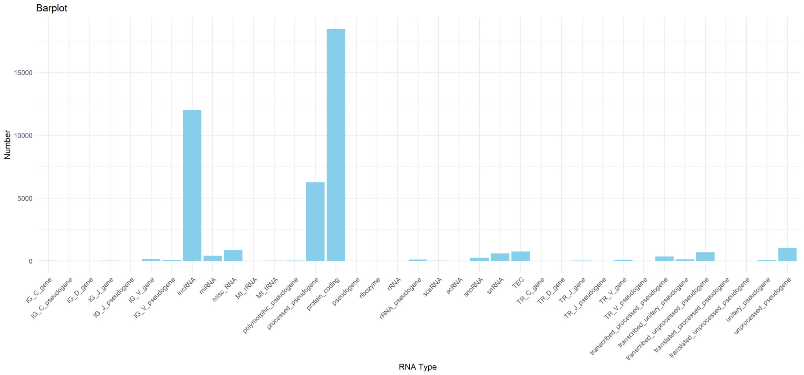

# TCGA-ESCA: Esophageal Cancer Gene Expression Analysis

RNA-seq gene expression analysis of esophageal carcinoma using TCGA-ESCA data from the Genomic Data Commons (GDC), with R and Bioconductor tools.

## Project overview

This project explores transcriptomic and selected clinical data from the TCGA-ESCA project. The main workflow retrieves STAR - Counts data, selects normal and primary tumor samples, prepares gene annotations, filters low-count features, classifies RNA types, and performs differential expression analysis with DESeq2.

**Current RNA-seq analysis subset:** 4 solid tissue normal samples and 4 primary tumor samples (8 samples total). This small subset is intended for workflow development and exploratory visualization, not definitive biological or clinical conclusions.

A separate exploratory workflow also matches the available RNA-seq sample barcodes to patient-level clinical records and examines gene-expression differences by recorded vital status (Alive/Dead). Only patients represented in both datasets can be included.

## Analysis workflows

### 1. Tumor versus normal transcriptomic analysis

1. Query TCGA-ESCA data from GDC with TCGAbiolinks.
2. Select four solid tissue normal and four primary tumor samples.
3. Download and prepare STAR - Counts gene expression data.
4. Annotate genes and filter low-count features.
5. Separate protein-coding, lncRNA, and miRNA features.
6. Perform differential expression analysis using DESeq2.
7. Visualize expression patterns using volcano plot, heatmap, PCA, and bar plots.

### 2. Clinical vital-status exploratory analysis

The script `scripts/04_clinical_vital_status_analysis.R`:

1. Retrieves TCGA-ESCA clinical records using `GDCquery_clinic()`.
2. Extracts patient-level `submitter_id` and `vital_status` (Alive/Dead).
3. Imports the raw RNA-seq count matrix while preserving the original TCGA sample barcodes.
4. Matches each RNA-seq sample to its clinical case using the first 12 characters of the TCGA barcode (patient identifier).
5. Creates a DESeq2 dataset using `design = ~ VitalStatus`.
6. Compares Dead versus Alive and exports complete, significant, and annotated result tables.

**Important distinction:** `VitalStatus` (Alive/Dead) is a patient clinical variable; it is not the tissue `SampleType` (Normal/Tumor). These are separate biological/clinical questions and should not be conflated.

## Repository structure

```text
TCGA-ESCA-Esophageal-Cancer/
├── TCGA-ESCA_Analysis.R
├── scripts/
│   └── 04_clinical_vital_status_analysis.R
├── README.md
├── figures/
│   ├── volcano_plot.png
│   ├── heatmap.png
│   ├── pca_plot.png
│   ├── rlog_barplot.png
│   └── rna_type_distribution.png
├── data/
│   └── README.md
└── results/
    └── README.md
```

## Analysis figures

### Volcano plot


### PCA plot


### Heatmap


### RNA type distribution


### rlog barplot


## Main tools

- R
- TCGAbiolinks
- SummarizedExperiment
- DESeq2
- ggplot2
- EnhancedVolcano
- pheatmap
- readxl

## Running the analyses

### Main RNA-seq workflow

1. Install R and the required packages listed in `TCGA-ESCA_Analysis.R`.
2. Download the TCGA-ESCA STAR - Counts data and prepare the gene annotation workbook.
3. Update the working-directory paths in the script to match your computer.
4. Run `TCGA-ESCA_Analysis.R` in RStudio in workflow order.

### Clinical vital-status workflow

1. Ensure that `8 Samples Raw data.txt` is available in the clinical analysis working directory. The file must contain the original TCGA sample barcodes; do not let R replace hyphens with dots (`check.names = FALSE`).
2. If gene-symbol annotation is required, place `Annot_df.txt` in the same working directory. Its row names should be Ensembl gene IDs and it should contain `Symbol` and `BioType` columns.
3. Open `scripts/04_clinical_vital_status_analysis.R` and update its `setwd()` path.
4. Run the script. It downloads the clinical data and writes matched metadata and DESeq2 result tables to the working directory.

Raw downloaded data, clinical exports, and annotation workbooks are not committed to this repository.

## Data availability

The project uses publicly accessible TCGA-ESCA data distributed through the Genomic Data Commons (GDC). Raw downloaded data and the external annotation workbook are not included in this repository.

## Important limitations and interpretation

- The main RNA-seq subset contains only eight samples (four normal and four tumor). Its results and visualizations are exploratory.
- The clinical dataset may contain many more patients than the RNA-seq subset. The clinical workflow can analyze only patients represented in both datasets; it does not treat all clinical records as if they had expression data.
- The Alive/Dead comparison is especially limited by the small number of matched RNA-seq samples and may be underpowered or confounded by tissue sample type. It must not be presented as a definitive prognostic signature or validated survival analysis.
- A DESeq2 comparison by vital status is not a time-to-event survival analysis. A proper survival analysis would require a sufficiently large and appropriately selected cohort plus follow-up time variables (for example, days to death or days to last follow-up), followed by methods such as Kaplan-Meier and Cox regression.
- Larger cohorts, appropriate study design, adjustment for relevant covariates, and independent validation are needed before drawing robust biological or clinical conclusions.

## Author

Yazdan Mottaghi
