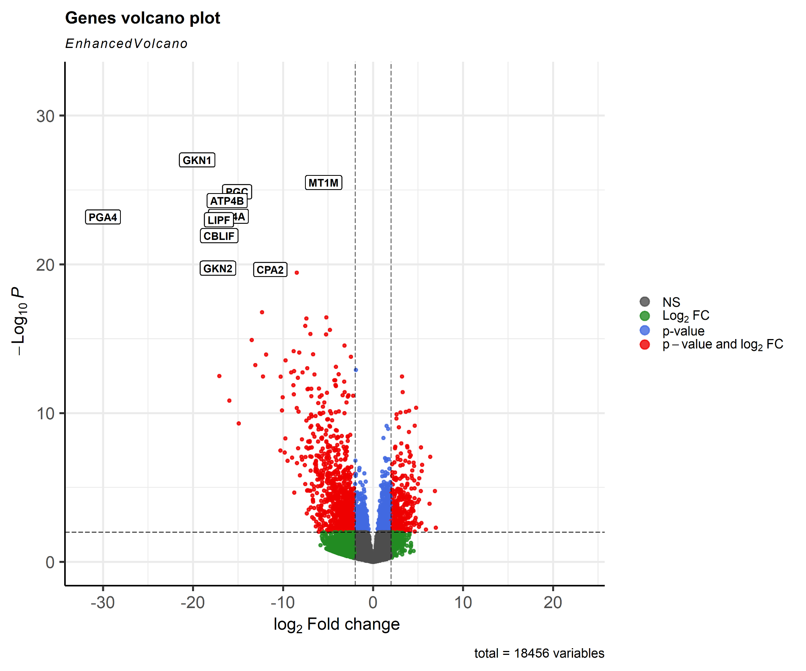
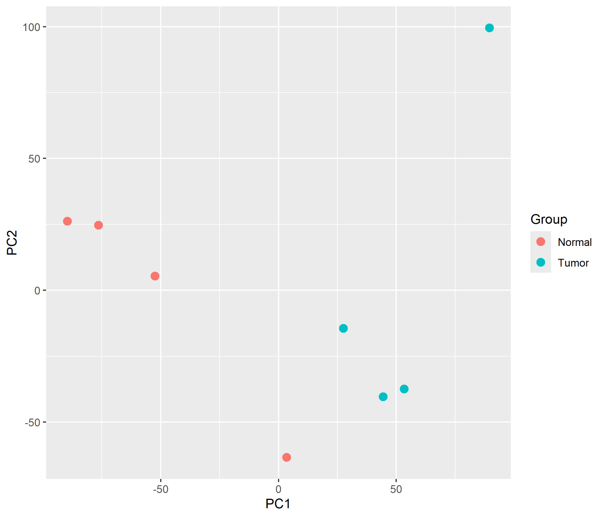
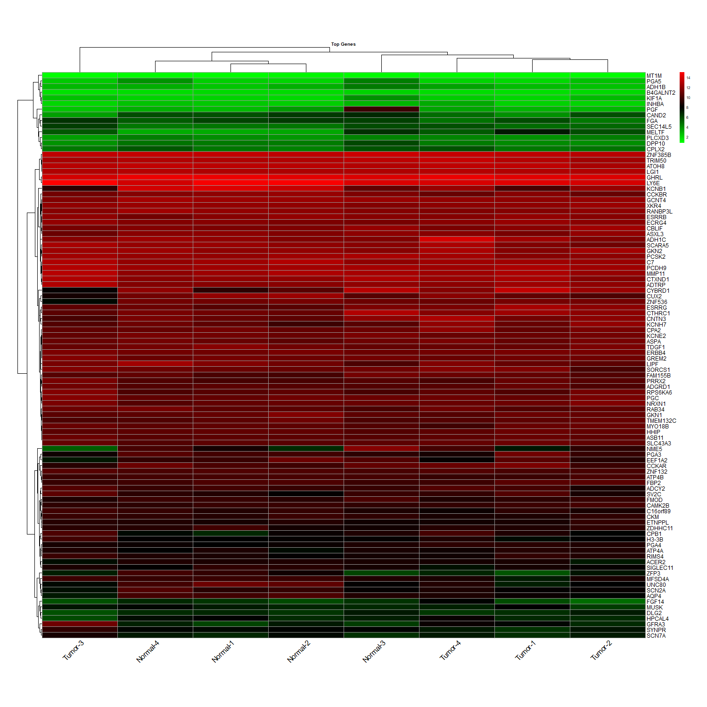
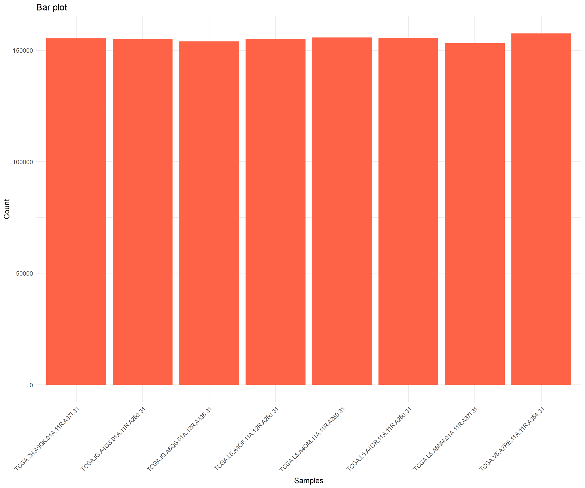

# TCGA-ESCA: Esophageal Cancer Gene Expression Analysis

RNA-seq gene expression analysis of esophageal carcinoma using TCGA-ESCA data from the Genomic Data Commons (GDC), with R and Bioconductor tools.

## Project overview

This project explores gene expression in esophageal carcinoma using the TCGA-ESCA project. The workflow retrieves STAR - Counts data, separates normal and primary tumor samples, performs gene annotation and filtering, classifies RNA types, and conducts differential expression analysis with DESeq2.

**Current analysis subset:** 4 solid tissue normal samples and 4 primary tumor samples (8 samples total). This small subset is intended for workflow development and exploratory visualization, not definitive biological or clinical conclusions.

## Workflow

1. Query TCGA-ESCA data from GDC with TCGAbiolinks.
2. Select four normal and four primary tumor samples.
3. Download and prepare STAR - Counts gene expression data.
4. Annotate genes and filter low-count features.
5. Separate protein-coding, lncRNA, and miRNA features.
6. Create sample metadata and perform differential expression analysis using DESeq2.
7. Visualize expression patterns using volcano plot, heatmap, PCA, and bar plots.

## Repository structure

```text
TCGA-ESCA-Esophageal-Cancer/
├── TCGA-ESCA_Analysis.R
├── README.md
├── figures/
│   ├── volcano_plot.png
│   ├── heatmap.png
│   ├── pca_plot.png
│   ├── rlog_barplot.png
│   └── rna_type_distribution.png
├── data/
│   └── README.md
└── results/
    └── README.md
```

## Analysis figures

### Volcano plot


### PCA plot


### Heatmap


### RNA type distribution


### rlog barplot


## Main tools

- R
- TCGAbiolinks
- SummarizedExperiment
- DESeq2
- ggplot2
- EnhancedVolcano
- pheatmap
- readxl

## Running the analysis

1. Install R and the required packages listed in the script.
2. Download the TCGA-ESCA STAR - Counts data and prepare the gene annotation workbook.
3. Update the working-directory paths in `TCGA-ESCA_Analysis.R` to match your computer.
4. Run the script in RStudio in workflow order.

The script currently refers to a local Windows directory and an external `Annotation.xlsx` file. These are not included in this repository and must be supplied locally.

## Data availability

The project uses publicly accessible TCGA-ESCA data distributed through the Genomic Data Commons (GDC). Raw downloaded data and the annotation workbook are not committed here.

## Important limitations

The current analysis uses only eight samples (four normal and four tumor). Results and visualizations should therefore be interpreted as exploratory examples of an RNA-seq analysis workflow. Larger, appropriately designed cohorts and additional validation are required before drawing robust biological conclusions.

## Author

Yazdan Mottaghi
